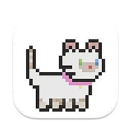
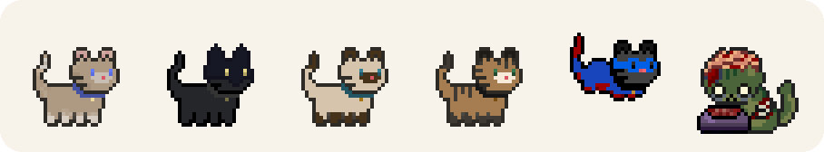
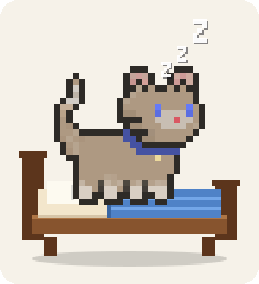

<div align="center">
  
  <h1>Kitty for Mint</h1>
  <p>Desktop pet mèo pixel-art cho Linux Mint — bản port từ <a href="https://github.com/wizenheimer/cupcake">Cupcake</a> (macOS).</p>
  <p>
    <a href="https://github.com/LeQuangHieu281206/kitty-for-mint">github.com/LeQuangHieu281206/kitty-for-mint</a>
  </p>
</div>






## Giới thiệu

Bản gốc Cupcake hiển thị mèo animation trên Dock của macOS. Linux không có Dock
kiểu đó, nên bản này biến mèo thành một **desktop pet**: cửa sổ trong suốt,
luôn nổi, kéo thả được, có menu chuột phải và tự nhớ vị trí.

- 18 nhân vật, 320 frame pixel-art.
- Animation `Chill`, `Wiggle`, các đòn đặc biệt và **Sleep** (ngủ) 4 frame:
  mèo nằm cuộn tròn, thở nhẹ, đầu và đuôi khẽ cử động. Riêng **Mint**
  (`xmas_cat`) có 8 frame ngủ vẽ tay: mèo Santa cuộn tròn, thở nhẹ.
- Click vào mèo để xem phản ứng nhảy/ăn; **click nhanh 3 lần** để mèo
  thoả mãn, tim bay lên.
- Kéo mèo để di chuyển: mèo nghiêng theo hướng kéo và có vệt tốc độ.
- Con trỏ đổi thành **bàn tay** khi trỏ vào mèo/giường: tay mở khi rê, tay nắm
  khi giữ và kéo.
- **Giường pet-bed pixel-art** dùng ảnh riêng (`assets/bed.png`), có thể đặt ở
  **bất kỳ đâu trên màn hình**. Kéo giường để dời; click giường để gọi mèo lên
  ngủ hoặc đánh thức.
- Ẩn/hiện giường bằng mục `Show Bed` trong menu chuột phải.
- Mèo ngủ **nằm cuộn** với `Zzz`, có thể ngủ ở bất kỳ đâu trên màn hình;
  khi ngủ trên giường, mèo thu nhỏ nằm gọn trong giường.
- Mèo và giường **luôn hiện trên mọi workspace**.
- Mèo **tự đi lang thang** trên màn hình, thỉnh thoảng ngủ tại chỗ hoặc lên
  giường ngủ rồi thức dậy. Có thể tắt bằng mục `Roam Freely`.
- Thả mèo lên giường bằng chuột trái: mèo tự nằm vào giường và ngủ.
- Tự lưu nhân vật, animation, vị trí mèo, vị trí/trạng thái ẩn hiện của giường
  và thiết lập lang thang vào `~/.config/cupcake/state.json`.
- Nhẹ: ~41–44 MB RAM, ~0.4% CPU khi idle, ~0.6% khi ngủ.

## Cấu hình máy đã kiểm thử

| Thành phần | Thông số |
|---|---|
| Máy | Dell Inspiron 15 3520 |
| Hệ điều hành | Linux Mint 22.3 “Zena” (nền Ubuntu 24.04 Noble) |
| Kernel | 7.0.0-38-generic, x86_64 |
| Desktop | GNOME 46.0, phiên **Wayland** (app chạy qua XWayland) |
| Màn hình | 1920 × 1080, 120 Hz |
| CPU | Intel Core i5-1135G7, 4 core / 8 thread, 2.4 GHz |
| RAM | 15 GiB khả dụng (16 GB) |
| Swap | 15 GiB: 7.6 GiB partition + 7.7 GiB zram |
| GPU | Intel Iris Xe (TigerLake-LP GT2) |
| Ổ cứng | NVMe: `/` 94 GB, `/home` 244 GB |
| Python | 3.12.3 |
| GTK | 3.24.41 |

Số liệu đo tại thời điểm kiểm tra: RAM đang dùng 12 GiB, còn 2.8 GiB khả dụng,
zram đang dùng 3.2 GiB. Bản thân app chỉ chiếm ~42 MB.

## Yêu cầu

- Linux Mint 21/22 hoặc Ubuntu/Debian có GTK3.
- Python 3.10+.
- Các gói:

```bash
sudo apt install -y python3-gi gir1.2-gtk-3.0 python3-gi-cairo
```

Linux Mint thường đã có sẵn cả ba gói.

## Cài đặt

```bash
git clone https://github.com/LeQuangHieu281206/kitty-for-mint.git
cd kitty-for-mint
./install.sh
cupcake
```

Lệnh cài sẽ:

1. Copy app vào `~/.local/share/cupcake`.
2. Tạo lệnh `cupcake` trong `~/.local/bin`.
3. Tạo mục **Cupcake** trong menu ứng dụng.

Nếu terminal báo không tìm thấy `cupcake`, thêm `~/.local/bin` vào `PATH` rồi
đăng nhập lại, hoặc chạy trực tiếp:

```bash
~/.local/bin/cupcake
```

Chạy không cần cài (dùng asset ngay trong repo):

```bash
python3 cupcake.py
```

## Sử dụng

- **Click chuột trái vào mèo**: mèo nhảy (hoặc ăn với Zombie) một lần rồi trở
  lại trạng thái bình thường. Click nhanh **3 lần** trong khoảng 1.1 giây để
  mèo thoả mãn: tim hồng bay quanh mèo. Nếu mèo đang ngủ, click sẽ đánh thức mèo.
- **Chuột trái + kéo**: di chuyển mèo tự do. Trong lúc kéo, mèo nghiêng theo
  hướng đi và có vệt tốc độ phía sau. Thả gần giường, mèo sẽ tự nằm vào giường
  và ngủ.
- **Con trỏ**: bàn tay mở khi trỏ vào mèo/giường, bàn tay nắm khi đang giữ và
  kéo, trở lại bàn tay mở khi thả.
- **Click giường**: gọi mèo lên giường ngủ; click lần nữa để đánh thức.
- **Kéo giường**: dời giường đến bất kỳ đâu trên màn hình. Vị trí được lưu.
- **Ẩn/hiện giường**: chuột phải vào mèo hoặc giường, bật/tắt `Show Bed`.
- **Chuột phải vào mèo hoặc giường**: chọn nhân vật, animation (gồm `Sleep`),
  `Go to Bed`/`Wake Up`, `Show Bed`, bật/tắt `Roam Freely`, random, About, Quit.
  `Sleep` cho mèo nằm ngủ ngay tại chỗ; `Go to Bed` gọi mèo lên giường.
- **Roam Freely**: mặc định bật. Mèo tự đi đến vị trí ngẫu nhiên, đôi khi nằm
  ngủ tại chỗ, đôi khi lên giường ngủ 30–90 giây rồi thức dậy. Tắt mục này nếu
  muốn mèo đứng yên.
- **Workspace**: mèo và giường được đánh dấu sticky nên luôn xuất hiện ở mọi
  workspace, không bị biến mất khi chuyển desktop.
- **Tray icon**: có trên Cinnamon/MATE/XFCE. Trên GNOME, tray icon bị bỏ qua vì
  GNOME không hiển thị tray kiểu cũ; dùng chuột phải vào mèo hoặc giường.

Bộ asset gốc không có frame ngủ hay frame kéo riêng. App ghép đầu và thân của
chính nhân vật đang chọn thành tư thế nằm cuộn, nhắm mắt, rồi vẽ `Zzz` bằng
cairo. Mint dùng sprite ngủ vẽ tay `assets/sleep_xmas_cat.png`, được làm nhấp
nhô nhẹ theo từng frame. Giường dùng ảnh pixel-art trong `assets/bed.png`, được
cắt bỏ viền trong suốt và thu về một nửa kích thước gốc.

Tự khởi động cùng phiên đăng nhập:

```bash
mkdir -p ~/.config/autostart
cp ~/.local/share/applications/cupcake.desktop ~/.config/autostart/
```

Gỡ cài đặt:

```bash
rm -rf ~/.local/share/cupcake
rm -f ~/.local/bin/cupcake ~/.local/share/applications/cupcake.desktop
rm -f ~/.config/cupcake/state.json
```

## Hiệu năng

Đo lại trên cấu hình ở trên, GNOME 46 Wayland qua XWayland (23/10/2026), có
giường và timer lang thang:

| Chỉ số | Kết quả |
|---|---|
| RAM (RSS) | ~41 MB khi ngủ; ~42–44 MB khi idle/đi bộ |
| CPU (idle, animation chạy) | ~0.4% một core |
| CPU (ngủ, có Zzz) | ~0.6% một core |
| CPU (đi bộ, cửa sổ di chuyển 25 lần/giây) | ~0.75% một core |
| Khởi động | ~121–143 ms (import + mở hai cửa sổ) |
| Chuyển animation | 2–3 ms |
| File descriptor | 13, không tăng |
| Kiểm tra | 18 nhân vật / 320 frame; 4 test pass |

Phần lớn bộ nhớ là thư viện GTK3 (~38 MB). App chỉ cache frame của nhân vật
hiện tại (idle/jump/sleep, kể cả bản lật trái) thay vì cache toàn bộ 320 frame.
Giường là cửa sổ trong suốt nhỏ, vẽ bằng cairo, không thêm asset hay ảnh nền.
Frame ngủ được sinh từ chính sprite của nhân vật nên không tăng dung lượng asset.

## Cấu trúc file

| File | Mô tả |
|---|---|
| `cupcake.py` | Toàn bộ app: cửa sổ mèo, giường, animation, di chuyển, menu, state |
| `install.sh` | Cài app vào `~/.local/share/cupcake` và tạo launcher |
| `test_cupcake.py` | Test frame, ID nhân vật, frame ngủ và ảnh giường |
| `assets/` | 320 frame PNG 32×32 của 18 nhân vật, `bed.png` và `sleep_xmas_cat.png` |
| `icon.png` | Icon ứng dụng 256×256 |
| `docs/preview.png` | Preview các nhân vật |
| `docs/sleep.png` | Preview mèo ngủ trên giường và ngủ tự do |
| `docs/reactions.png` | Preview hiệu ứng click thoả mãn và kéo mèo |
| `LICENSE` | Giấy phép MIT |
| `.gitignore` | Bỏ qua `__pycache__`, `*.pyc` |

Chạy test:

```bash
python3 -m unittest test_cupcake.py -v
```

## Ghi chú về dock

GNOME Shell vẽ dock bên trong shell, nên app không thể chèn một item vào danh
sách icon của Dash2Dock Lite. Giường là một cửa sổ trong suốt nhỏ, luôn nổi;
lần đầu nó nằm gần mép phải dock, sau đó bạn có thể kéo đến bất kỳ đâu trên
màn hình. Vị trí và trạng thái ẩn/hiện được lưu lại. Nếu đổi theme hoặc độ
phân giải, kéo giường để canh lại hoặc bật/tắt `Show Bed`.

## Ghi chú Wayland

GTK3 không thể tự đặt vị trí hoặc giữ cửa sổ luôn nổi trên Wayland. Vì vậy app
tự đặt `GDK_BACKEND=x11` và cả mèo lẫn giường chạy qua **XWayland**; trên GNOME
Wayland đã kiểm tra vị trí, di chuyển cửa sổ và `_NET_WM_STATE_ABOVE` hoạt động.

Muốn thử native Wayland (vị trí và lớp cửa sổ do compositor quyết định):

```bash
GDK_BACKEND=wayland python3 cupcake.py
```

## Nguồn gốc và giấy phép

- Dự án gốc: [wizenheimer/cupcake](https://github.com/wizenheimer/cupcake) — MIT.
- Pixel-art assets lấy từ dự án gốc.
- Bản port Linux Mint: [LeQuangHieu281206](https://github.com/LeQuangHieu281206).

Phát hành theo giấy phép [MIT](LICENSE).
